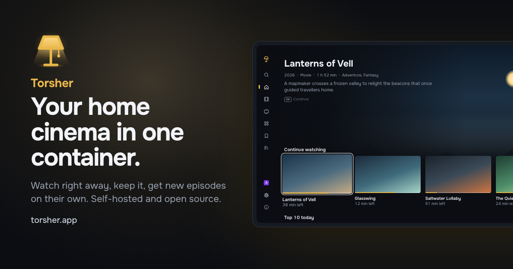

<p align="center">
  
</p>

<h1 align="center">Torsher</h1>
<p align="center">
Your home cinema in one container.
</p>

<p align="center">
  <strong>Watch a torrent right away, keep what you watched in your own library, and let new episodes arrive on their own.</strong>
  <br>
  Self-hosted and open source, built for the TV first.
</p>

<p align="center">
  
  
  
  
</p>

<p align="center">
  <a href="https://torsher.app/docs/install/docker-compose">Install</a> &nbsp;|&nbsp;
  <a href="https://torsher.app/docs/">Documentation</a> &nbsp;|&nbsp;
  <a href="https://github.com/torsher-app/torsher/releases">Releases</a> &nbsp;|&nbsp;
  <a href="https://torsher.app">Website</a>
</p>

<br>

<p align="center">
  
</p>

<p align="center">
  <sub>Runs on x86-64 and arm64 Linux · Watch in a browser or on LG webOS</sub>
  <br>
  <sub>Titles and artwork in the picture are made up.</sub>
</p>

<br>

## Support

Torsher is open source and built by one developer. Donations are its only funding: there are no paid features, no ads and no telemetry. Donations pay for development time and test hardware and have nothing to do with content or the sources you connect.

See the [Donate](https://torsher.app/donate) page.

## About

Torsher started when I bought a mini PC with an Intel N150 as a home server and set up the usual self-hosted media stack on it: Jellyfin, Sonarr, Radarr, Prowlarr and Seerr. It worked, but I got tired of keeping it together. Each app has its own interface, settings and database, they all have to be wired to each other, and the TV is only the last link in the chain.

So I built the one thing I wanted instead: a media center in one Docker container, on a mini PC, a NAS or a desktop. One process with one database and one interface does the jobs of a torrent client, a media server, series and movie managers and a request app, and the TV comes first. The indexer stays outside: Torsher connects to any Torznab indexer, for example Prowlarr or Jackett.

## Features

### Watch right away

Pick a title and select **Watch**. Torsher finds releases in your indexers and starts playback while the file downloads.

- Releases ranked by quality and voice-over, with dubbing and voice-over studios shown
- Downloads a few minutes ahead of where you are and stops when you close the player, so nothing fills your disk by accident
- Audio and subtitle tracks switch in the player
- When a TV or a browser can't play a file, the server converts it on the fly, on the GPU if it has one

### Your library

What you watch stays in a cache that cleans itself up. **Keep** moves the file into your library.

- Laid out by title so Jellyfin, Plex and Kodi can read it too
- On one volume a kept file is hard-linked: it keeps seeding and takes no extra space
- Folders you already have are indexed in place and never written to
- Home videos get their own section

### Follow

**Follow** a series on the TV, and new episodes download into your library on their own.

- From the episode you choose, in your voice-over and the best quality released
- The same voice-over for the whole season
- A followed movie downloads once it is out digitally
- The control panel lists every follow with its episodes and the releases found for each

### A showcase made for the TV

Movies and series with posters, descriptions, cast and ratings from TMDB.

- Arrows, OK and Back on the remote, or the Magic Remote pointer and a mouse in any browser
- Profiles for the household, each with its own progress, lists, ratings and language and an optional PIN
- Progress belongs to the title, not the file: switch the release and keep your place
- Written for the browser engine of LG TVs from 2020

### Control panel

Everything is set up in the browser, on a phone or a computer: sources, storage, profiles and devices.

- A setup wizard that checks storage, the network and your indexer
- DNS over HTTPS and routes through your own SOCKS5 or HTTP proxy, per host
- Daily database backups, restore and export to another server
- Notifications about problems, finished downloads and new episodes in Telegram, a webhook, ntfy, Gotify or email

## Quick start

You need a computer with Docker and the Compose plugin. Linux gets every feature; Docker Desktop on macOS and Windows transcodes on the CPU only.

1. Download the install file, `docker-compose.yml` from the [latest release](https://github.com/torsher-app/torsher/releases/latest), into an empty folder:

   ```bash
   mkdir torsher && cd torsher
   curl -fsSL https://github.com/torsher-app/torsher/releases/latest/download/docker-compose.yml -o docker-compose.yml
   ```

2. Find your user and group IDs. If they are not both `1000`, put them into `PUID` and `PGID` in `docker-compose.yml`:

   ```bash
   id -u && id -g
   ```

3. Start Torsher together with Prowlarr, the indexer manager. If you already run a Torznab indexer, `docker compose up -d` starts Torsher alone:

   ```bash
   docker compose --profile prowlarr up -d
   ```

4. Open `http://<server-address>:8080/panel/` and create the owner account. The setup wizard asks for Prowlarr's API key: add the indexers you are allowed to use in Prowlarr at `http://<server-address>:9696` first.

5. Install the [Torsher app](https://torsher.app/docs/tv/lg-webos) on an LG TV, or open `http://<server-address>:8080/` in a browser. Enter the code from the screen in the panel under **Profiles & devices → Connect a device**.

The [Quick start](https://torsher.app/docs/quick-start) walks through each step, and [Docker Compose](https://torsher.app/docs/install/docker-compose) explains every line of the install file, several disks and updates.

## Platforms

| Platform | Status | |
| --- | --- | --- |
| Web browser | Available | The showcase on any computer, and the control panel on a phone or a computer |
| LG webOS | Available | A thin TV app that plays most files directly on the TV |
| Android TV | Planned | The same showcase with a native player |
| Apple TV and phones | Planned | Through apps that already exist for these devices |

The server runs on x86-64 Linux, including NAS systems on x86, with arm64 Linux and Docker Desktop on a best-effort basis. See [Requirements](https://torsher.app/docs/install/requirements).

## Sources

Torsher does not include, host or index any content, and comes with no sources enabled. You connect the sources yourself, for example any Torznab indexer such as Prowlarr or Jackett, and you are responsible for making sure you are allowed to use them.

The project runs no servers for your content and collects no telemetry. The only request a server makes on the project's behalf is a daily update check against this repository's releases on GitHub, without identifiers; it can be turned off in the panel.

Movie and series information and images come from [The Movie Database (TMDB)](https://www.themoviedb.org/). This product uses the TMDB API but is not endorsed or certified by TMDB.

## Contributions

Torsher does not accept external pull requests. To report a bug, please [open an issue](https://github.com/torsher-app/torsher/issues) with what you did, what you expected and the file from **Download logs** under **Logs** in the panel. Issues are also welcome for release titles Torsher reads wrong and for reports from your hardware: a NAS, an older LG TV or an ARM board.

## Build Locally

<details>
<summary>Instructions for building from source</summary>

### Prerequisites

- Node.js 24 and pnpm (`corepack enable`)
- Go 1.24+ for the torrent engine
- `ffmpeg` and `ffprobe` for audio and subtitle tracks and remuxing

### Install Dependencies

```bash
pnpm install
```

### Check

```bash
pnpm lint
pnpm typecheck
pnpm test
```

### Development

`pnpm dev` starts the server, the panel and the showcase with hot reload:

```bash
pnpm dev
```

It builds the torrent engine in `engine/` (Go, built on [anacrolix/torrent](https://github.com/anacrolix/torrent)) into the server data folder on start; without Go, the server starts without it. To build the engine separately:

```bash
pnpm --filter @torsher/server engine:build
```

To use a prebuilt binary instead, set `ENGINE_PATH` in `apps/server/.env`. Without `ffmpeg` and `ffprobe` in `PATH` (or their paths in `FFMPEG_PATH` and `FFPROBE_PATH`), the player plays files directly.

### Build

`pnpm build` builds the showcase and the panel, which the server then serves itself: the showcase at `/`, the panel at `/panel/` and the API at `/api`.

```bash
pnpm build
```

The Docker image:

```bash
docker buildx build --platform linux/arm64 -t torsher:dev --load .
```

A local build has no TMDB app key: set `TMDB_ACCESS_TOKEN` or add your own key in the panel. To build with a key, pass it as a build secret:

```bash
docker buildx build --secret id=tmdb_app_key,env=TMDB_ACCESS_TOKEN -t torsher:dev --load .
```

</details>

## License

[AGPL-3.0](LICENSE)

Copyright (c) 2026-present, [Anton Reshetov](https://github.com/antonreshetov).
